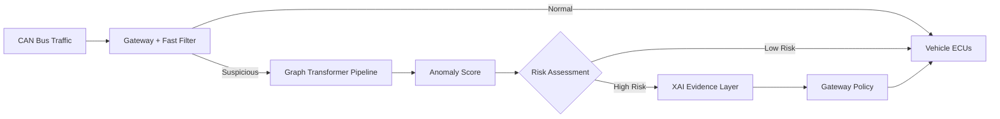
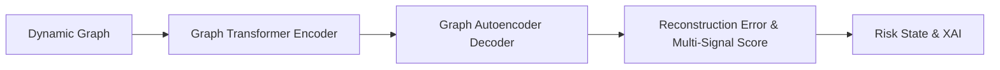
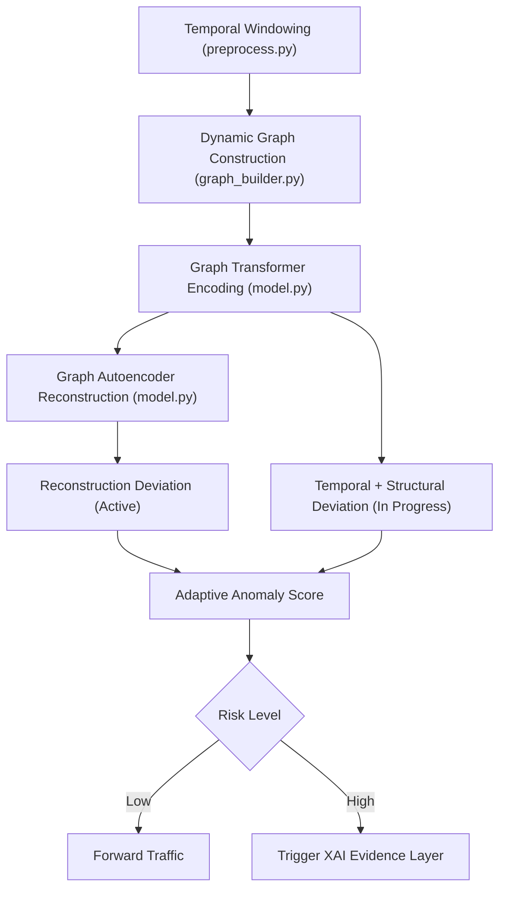
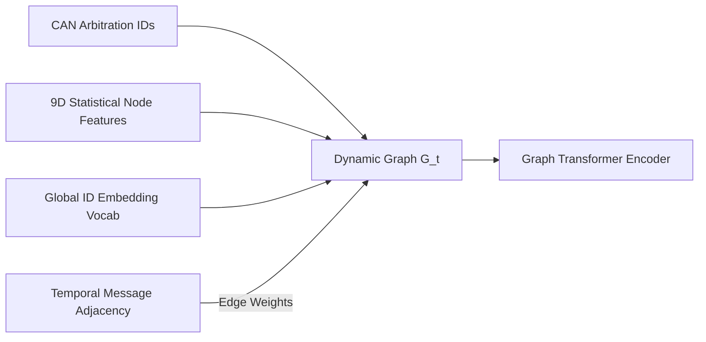
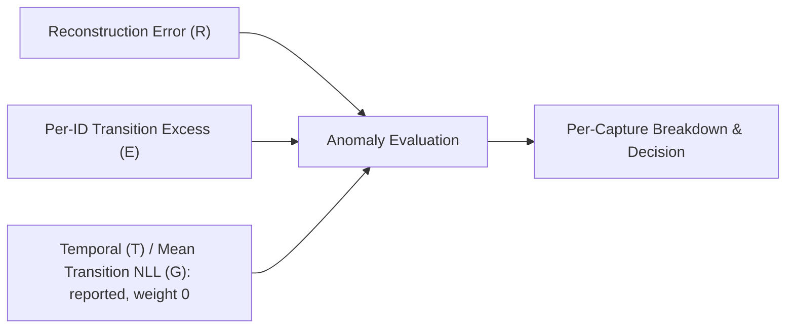
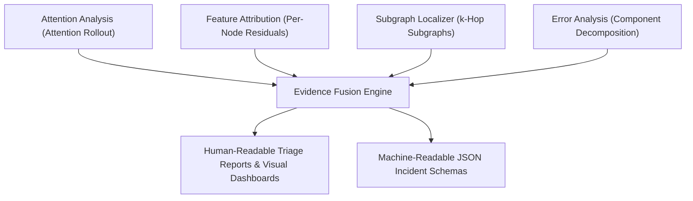
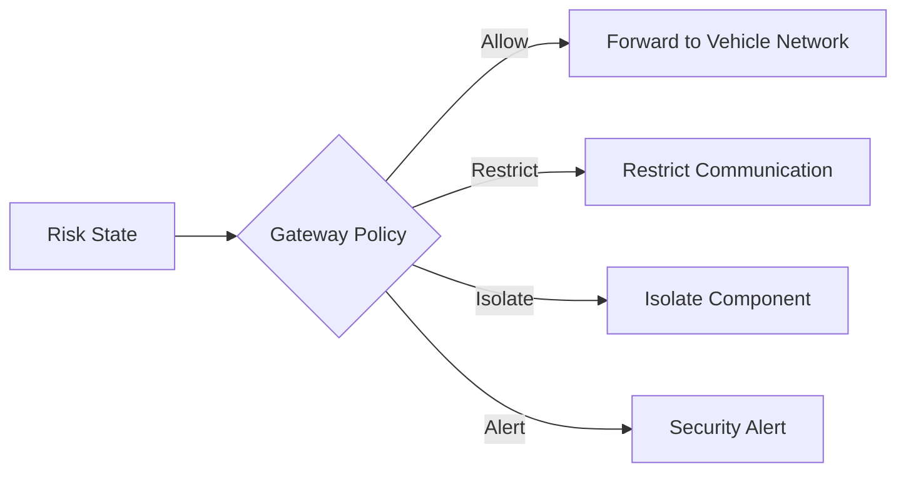

# An Explainable Graph-Based Transformer for Zero-Day Attack Detection in Autonomous Vehicles


> **Note on project status:** The full MVP pipeline is **implemented and functional** end-to-end. This includes ROAD dataset ingestion, temporal windowing, dynamic graph construction, the coupled `GraphTransformerAutoencoder`, multi-component anomaly scoring, and a complete Explainable AI (XAI) evidence layer (`explainability/`) that generates structured JSON incident reports, natural language triage summaries, and a unified 4-panel visual dashboard. Measured zero-day detection performance on real ROAD attacks, 6-fold capture rotation (mean ± std): **ROC-AUC 0.967 ± 0.005 · recall 85.7% ± 5.3% · precision 67.7% ± 20.3% · F1 72.9% ± 14.8%**; seed-42 model: **ROC-AUC 0.9672 · PR-AUC 0.9081 · F1 0.8496 · FPR 5.04%**. Explanation fidelity **HR@1 90.3% · HR@3 94.1%** against ROAD's injected IDs. Synthetic timing attacks (fabrication, suspension, clock drift, flooding) are reported separately (§17). Gateway containment policy simulation and post-MVP refinements remain as future work.

---

## Table of Contents

1. [Introduction](#1-introduction)
2. [Problem Statement](#2-problem-statement)
3. [Research Motivation](#3-research-motivation)
4. [Research Gap](#4-research-gap)
5. [Objectives](#5-objectives)
6. [Proposed Solution](#6-proposed-solution)
7. [Overall Architecture](#7-overall-architecture)
8. [Detection Pipeline (Workflow)](#8-detection-pipeline-workflow)
9. [Technology Stack](#9-technology-stack)
10. [Directory Structure](#10-directory-structure)
11. [Installation](#11-installation)
12. [Usage](#12-usage)
13. [Graph Construction](#13-graph-construction)
14. [Anomaly Scoring](#14-anomaly-scoring)
15. [Explainability Layer](#15-explainability-layer)
16. [Gateway Policy & Containment](#16-gateway-policy--containment)
17. [Evaluation Metrics](#17-evaluation-metrics)
18. [Future Work](#18-future-work)

---

## 1. Introduction

This project proposes an **explainable, graph-based security architecture** for detecting previously unseen ("zero-day") attacks on the Controller Area Network (CAN) bus of an autonomous vehicle. CAN traffic between Electronic Control Units (ECUs) is represented as a **dynamic graph**, which is processed by a **Graph Transformer** to learn the structural and temporal behavior of normal vehicle communication. A **Graph Autoencoder** built on top of this representation flags deviations from learned normal behavior, producing an adaptive anomaly score rather than relying solely on predefined attack signatures. An **Explainable AI (XAI) layer** then converts the model's internal evidence into a human-readable security explanation, which is handed to a separate gateway policy layer responsible for enforcement.

The intended audience for this repository includes recruiters and hiring managers evaluating applied ML/security work, professors and thesis committees assessing research contribution and rigor, and automotive-security or ML researchers interested in graph-based intrusion detection.

## 2. Problem Statement

CAN was designed for efficient, reliable communication between ECUs, not for security. It provides no native authentication, encryption, or intrusion detection, which means a compromised or spoofed ECU can inject malicious frames that appear to come from a legitimate component. Signature-based Intrusion Detection Systems (IDS) can catch known attack patterns, but they share a fundamental limitation:

> A previously unseen attack may not match any known signature.

This project proposes a graph-based, **behavioral anomaly detection** system that learns what *normal* CAN network behavior looks like — structurally and temporally — so that deviations, including attacks with no prior signature, can be flagged and explained, rather than only classified against a fixed attack list.

## 3. Research Motivation

CAN networks are particularly challenging to secure because many ECUs share a single communication bus, and any node on that bus can, in principle, inject frames. As vehicles add more connected ECUs and external interfaces (telematics, infotainment, V2X), two problems become critical:

- **Unknown attack coverage** — signature-based IDS only detects attacks it has already seen. Novel injection, spoofing, or fuzzing strategies can bypass static rule sets entirely.
- **Decision opacity** — even when an anomaly-based model flags suspicious traffic, a raw anomaly score gives a security engineer (or an automated gateway) little to act on. Understanding *which ECUs, which frames, and which relationships* drove the alert is important for triage, trust, and any eventual safety certification.

A dynamic graph representation combined with attention-based modeling is a natural fit for both problems: graphs capture the relational structure between ECUs and messages without hand-crafted feature engineering, and both attention weights and reconstruction error offer inspectable signals that can be turned into explanations rather than a single opaque score.

## 4. Research Gap

| Existing Approach | Limitation |
|---|---|
| Signature-based IDS (rule/pattern matching) | Cannot detect attacks that do not match a known signature; requires continuous manual rule updates |
| Statistical / frequency-based anomaly detection (e.g., message timing or entropy thresholds) | Captures simple timing anomalies but ignores relational structure between ECUs; prone to false positives under legitimate but bursty traffic |
| Classical machine learning classifiers (e.g., SVM, Random Forest on handcrafted features) | Requires labeled attack data for training; generalizes poorly to attack types not present in the training set |
| Deep learning IDS without graph structure (e.g., CNN/LSTM on raw CAN sequences) | Can model temporal patterns but does not explicitly represent the relational structure between ECUs and message IDs |
| Graph Neural Network (GNN)-based IDS | Captures relational structure, but standard message-passing GNNs have limited long-range attention and typically offer weaker built-in interpretability than attention-based models |
| Most anomaly-based automotive IDS research | Rarely pairs graph-based relational reasoning **with** a dedicated, evidence-based explainability layer and a decoupled containment policy in the same system |

The gap this project targets is the **combination** of (a) dynamic graph modeling of CAN traffic reasoned over by a Graph Transformer, (b) unsupervised anomaly detection via a Graph Autoencoder so the system is not limited to known attack labels, and (c) a dedicated XAI evidence layer feeding a separate, explicit gateway policy — rather than any single one of these components in isolation.

## 5. Objectives

- Model CAN bus traffic as a dynamic graph of ECUs and message relationships.
- Use a Graph Transformer to learn the structural and temporal behavior of normal vehicle communication.
- Use a Graph Autoencoder to detect deviations from learned normal behavior without depending entirely on labeled attack signatures.
- Combine reconstruction, temporal, and graph-structural deviations into a single adaptive anomaly score.
- Build an XAI evidence layer that turns model internals (attention, reconstruction error, graph structure) into a human-readable security explanation.
- Keep detection/explanation (ML) and containment (gateway policy) as clearly separated responsibilities.
- Evaluate the approach against classical and deep-learning IDS baselines on both known and simulated zero-day attacks.

## 6. Proposed Solution

The proposed system sits behind a fast deterministic filter at the vehicle gateway: traffic that is clearly normal or clearly invalid is handled immediately, while suspicious or uncertain traffic is passed into the learned pipeline. That traffic is windowed in time, converted into a **dynamic graph** of ECUs and message relationships, and encoded by a **Graph Transformer** into a latent representation. A **Graph Autoencoder** attempts to reconstruct that representation; the reconstruction error, combined with temporal and graph-structural deviation signals, produces an **adaptive anomaly score**. Traffic assessed as high-risk is passed to an **XAI evidence layer**, which fuses attention analysis, feature attribution, graph explanation, and error analysis into a security explanation and a risk state. That risk state — not the raw model — drives the **gateway policy**, which decides whether to allow, restrict, isolate, or alert.

**Why this design?**

| Decision | Reason |
|---|---|
| Graph representation instead of raw/flattened CAN frames | Naturally captures relationships between ECUs and message IDs, and scales to a variable, evolving set of bus participants |
| Graph Transformer instead of a standard GNN | Self-attention lets any node attend to any other node directly (not just local neighbors after k hops), and attention weights are a natural interpretability signal |
| Graph Autoencoder for anomaly detection instead of a supervised classifier | Learns what *normal* traffic looks like from largely unlabeled data, so it is not limited to attacks seen during training — a requirement for zero-day detection |
| Combining reconstruction, temporal, and structural deviation into one score | A single deviation signal (e.g., reconstruction error alone) can miss attacks that are structurally anomalous but locally well-reconstructed, or vice versa |
| Separate XAI evidence layer | Decouples "why is this suspicious" from "what should the vehicle do about it," so the explanation stays interpretable even as the model or policy evolves independently |
| Fast deterministic filter ahead of the learned pipeline | Keeps latency low for the vast majority of normal traffic; the (comparatively) heavier graph pipeline is only invoked for traffic that needs deeper analysis |
| Gateway policy as a distinct enforcement layer | Keeps security *enforcement* (allow/restrict/isolate/alert) as an explicit, auditable policy decision rather than an implicit side-effect of the model |

## 7. Overall Architecture



The gateway's fast filter forwards clearly normal traffic directly to the vehicle ECUs and routes only suspicious or uncertain traffic into the graph-based pipeline. That pipeline produces an anomaly score which drives a risk assessment: low-risk traffic is forwarded, while high-risk traffic is routed through the XAI evidence layer to produce an explanation, which in turn informs the gateway policy's enforcement decision.

### Decision Flow (high level)



**Why this separation?** Splitting "graph representation," "relational reasoning," "reconstruction-based detection," and "risk scoring" into distinct stages keeps each component independently testable — the Graph Transformer's embeddings can be evaluated on their own, and the anomaly-scoring logic can be tuned or replaced without changing how the graph itself is built.

## 8. Detection Pipeline (Workflow)



CAN traffic that reaches the learned pipeline is first grouped into temporal windows, then assembled into a dynamic graph of CAN arbitration IDs and message transition relationships. The Graph Transformer encodes that graph, and the Graph Autoencoder attempts to reconstruct the node statistical features and structural edges. The reconstruction error (currently evaluated per capture on held-out attacks) is combined with temporal and graph-structural deviation signals to distinguish normal driving behavior from zero-day masquerade and injection attacks.

**Status: Core Representation & Reconstruction Detection Implemented.** The windowing, graph builder, coupled model, and benign-only training with per-capture evaluation are functional in `graph-transformer/`. Extended anomaly score fusion and XAI evidence generation are in active development.

## 9. Technology Stack

| Layer | Technology | Status |
|---|---|---|
| Programming Language | Python 3.10+ | ✅ Implemented |
| Deep Learning Framework | PyTorch (>= 2.1) | ✅ Implemented |
| Graph Neural Network / Attention Layers | PyTorch Geometric (`TransformerConv` multi-head edge-conditioned attention) | ✅ Implemented |
| Autoencoder Architecture | Coupled `GraphTransformerAutoencoder` (MLP node feature decoder + inner-product edge decoder) | ✅ Implemented |
| CAN Data Source | ROAD (Real Autonomous Driving) Dataset (ORNL) — signal-translated ambient + attack captures | ✅ Implemented |
| Preprocessing & Windowing | Custom sliding-window parser (`preprocess.py`) with configurable strides | ✅ Implemented |
| Dynamic Graph Generation | Custom PyG graph builder (`graph_builder.py`) with 9D node stats & ID vocabulary embedding | ✅ Implemented |
| Multi-Component Anomaly Scoring | `ZeroDayDetector` fusing reconstruction (R), temporal (T) and structural (G) signals | ✅ Implemented |
| Explainability Layer | Attention Rollout + Feature Attribution + Subgraph Localizer + Incident Report Generator + Visual Dashboard | ✅ Implemented (MVP) |
| XAI Evaluation Suite | `evalxai.py` — HR@1, HR@3, Feature Grounding Fidelity against ROAD metadata and can-train-and-test per-frame labels | ✅ Implemented |
| Synthetic Attack Injector | `attack_injector.py` — fabrication, suspension, clock drift, flooding at a fixed 3-level grid, injected only into test-held captures | ✅ Implemented |
| Capture-Rotation Evaluation | `train.py --fold i --n-folds 6` + `evaluate.py --folds 6` — every benign capture tested exactly once | ✅ Implemented |
| Unit Test Suite | `tests/test_pipeline.py`, `tests/test_xai.py`, `tests/test_injector.py`, `tests/test_converter.py` — 24 tests | ✅ Implemented |
| Second Dataset | can-train-and-test (DTU; 4 real vehicles, 7.5 GB) in `the second/`, gitignored; `convert_can_train_and_test.py` + `CAN_DATASET` switch | ✅ Implemented (per-set runs) |
| Gateway / Policy Simulation | Custom rule-based policy engine for allow/restrict/isolate/alert decisions | 🔲 Planned |
| Experiment Tracking | PyTorch checkpoints + per-capture metric logs (TensorBoard/W&B integration planned) | 🔲 Planned |

## 10. Directory Structure

```
capstone/
├── attack-detection/          # Module: Zero-day detection — ZeroDayDetector, AnomalyScorer, TransitionBaseline
│   ├── detector.py            # ZeroDayDetector: calibrate, evaluate_graph, risk state
│   ├── scorer.py              # AnomalyScorerConfig + TransitionBaseline NLL scoring
│   ├── evaluate.py            # Zero-day benchmark — ROC-AUC, PR-AUC, F1, FPR, detection latency
│   ├── plot_confusion_matrix.py       # Grayscale publication-quality 2x2 confusion matrix
│   ├── plot_scenario_explainer.py     # Black-and-white 2x2 scenario infographic table
│   ├── generate_confusion_explainer.py# Standalone interactive HTML telemetry animation
│   ├── index.json             # Centralized scenario metadata and plain-English descriptions
│   └── README.md              # Scoring architecture, evaluation, and explainer suite
├── explainability/            # Module: Full XAI evidence layer (MVP complete)
│   ├── attention_analyzer.py  # Multi-head attention extraction + Attention Rollout
│   ├── attribution.py         # Per-node & per-feature reconstruction error decomposition
│   ├── graph_localizer.py     # k-hop subgraph extraction + sequence NLL annotation
│   ├── report_generator.py    # JSON + text security incident report generator
│   ├── evalxai.py             # XAI fidelity benchmark (HR@1, HR@3, Feature Grounding)
│   ├── plot_component_radar.py       # Polar spider chart — normalised component deviation
│   ├── plot_id_attribution.py        # Dual-panel CAN ID + feature attribution bar chart
│   ├── plot_interactive_subgraph.py  # Interactive HTML5 + static PNG subgraph network
│   ├── plot_xai_dashboard.py         # Unified 4-panel Matplotlib dashboard
│   └── README.md              # XAI pipeline design, schemas, and evaluation protocol
├── graph-transformer/         # Module: Core representation learning & GAE detection pipeline
│   ├── CHANGELOG.md           # Milestone & engineering change history
│   ├── README.md              # Detailed architecture, schema, & usage documentation
│   ├── preprocess.py          # Data ingestion & temporal windowing for ROAD dataset
│   ├── graph_builder.py       # Dynamic graph construction (9D node features, benign-only ID vocab, directed edges)
│   ├── attack_injector.py     # Synthetic timing attacks -> outputs/synthetic/ (+ metadata.json)
│   ├── convert_can_train_and_test.py  # Raw frames (hex payload) -> ROAD CSV layout, one set at a time
│   │                                  # graph_builder.py windows + builds graphs per capture (low memory)
│   ├── model.py               # Coupled GraphTransformerAutoencoder (TransformerConv + MLP/edge decoders)
│   ├── train.py               # Benign-only training, capture split / 6-fold rotation, leakage-safe test assignment
│   ├── road/                  # Local ROAD dataset directory (signal-translated CSVs)
│   └── outputs/               # graphs.pt, vocab.pkl, best_model.pt, folds/, synthetic/, fold_results.json, xai_visuals/
├── tests/
│   ├── test_pipeline.py       # 10 unit tests: detector contracts, metric correctness, edge cases
│   ├── test_xai.py            # XAI component unit tests
│   ├── test_injector.py       # Injector behaviour, fold disjointness, synthetic leakage rule
│   └── test_converter.py      # Payload bytes, hex IDs, labels, short/empty DLC
├── new/                       # VS Code notebooks, one per pipeline step (thin runners over the modules) + run logs
│   ├── graph2/                # 01_preprocess, 02_graph_builder, 03_train
│   ├── attack2/               # 01_evaluate
│   ├── explainability2/       # 01_evalxai
│   └── logger/                # Logs of every run, per dataset (ctt_set_01..04/)
├── the second/                # can-train-and-test dataset + DATASET_INFO.md (gitignored, local only)
├── requirements.txt           # Core Python dependencies
├── CHANGELOG.md               # Project-level milestone history
├── task_list.md               # Architecture review checklist & implementation plan
├── LICENSE                    # MIT License
└── README.md                  # Project overview and research documentation
```

## 11. Installation

**Status: Fully Functional.** All pipeline stages through XAI visual dashboards are implemented and runnable. See the [CHANGELOG](CHANGELOG.md) for the complete engineering history.

```bash
# 1. Clone the repository
git clone https://github.com/Etrlnx/pjt_1.git
cd pjt_1

# 2. Create a virtual environment
python -m venv venv
source venv/bin/activate  # on Windows: venv\Scripts\activate

# 3. Install PyTorch and PyTorch Geometric FIRST, following official platform/CUDA selectors:
#      - PyTorch:           https://pytorch.org/get-started/locally/
#      - PyTorch Geometric: https://pytorch-geometric.readthedocs.io/en/latest/install/installation.html

# 4. Install remaining dependencies
pip install -r requirements.txt

# 5. Download and extract the ROAD dataset under graph-transformer/road/
#    The directory structure should be:
#    graph-transformer/road/road/signal_extractions/ambient/*.csv
#    graph-transformer/road/road/signal_extractions/attacks/*.csv
```

## 12. Usage

**Notebooks:** `new/` has one VS Code notebook per step. Each notebook only sets `CAN_DATASET` and calls the modules below, so it always runs the same code as the scripts.

The full pipeline runs in sequence from the repository root:

```bash
# Step 0 (optional): Generate synthetic timing attacks from the ambient captures
python graph-transformer/attack_injector.py
# -> Emits outputs/synthetic/*.csv + metadata.json (picked up by preprocess.py)

# Step 1: Preprocess raw ROAD dataset into temporal window records (2.0 s windows, 1.0 s stride)
python graph-transformer/preprocess.py
# -> Emits outputs/road_windowed.pkl (window index + labels; raw messages are re-read by graph_builder.py)

# Step 2: Build dynamic PyTorch Geometric graphs and global ID vocabulary (one capture at a time)
python graph-transformer/graph_builder.py
# -> Emits outputs/graphs.pt and outputs/vocab.pkl

# Step 3: Train Graph Transformer + Autoencoder on benign captures
python graph-transformer/train.py
# -> Saves outputs/best_model.pt with weights, vocab, splits, and normalizer
python graph-transformer/train.py --fold 0 --n-folds 6   # repeat for folds 0-5 -> outputs/folds/fold_i.pt

# Step 4: Run the zero-day detection benchmark on held-out attack captures
python attack-detection/evaluate.py
# -> Prints ROC-AUC, PR-AUC, F1, FPR, detection latency per attack family
# -> Displays Confusion Matrix & Scenario Table windows + launches interactive browser simulation
python attack-detection/evaluate.py --folds 6
# -> Per-fold + mean +- std ROAD metrics and pooled synthetic results -> outputs/fold_results.json

# Step 5: Run the XAI fidelity benchmark and generate visual dashboards
python explainability/evalxai.py          # saves PNGs + HTML to outputs/xai_visuals/
python explainability/evalxai.py --show   # same + opens interactive Matplotlib windows
python explainability/evalxai.py --timing # rate term on: score and attribution use max(E, T)
```

**Second dataset (can-train-and-test).** Every script reads the `CAN_DATASET` environment variable:
- `road` (the default) keeps the paths above.
- Any other name reads `the second/converted/<name>/` and writes to `graph-transformer/outputs/<name>/`, so each dataset gets its own vocabulary, transition baseline and models.

```bash
python graph-transformer/convert_can_train_and_test.py set_01   # -> the second/converted/ctt_set_01/
export CAN_DATASET=ctt_set_01                                     # PowerShell: $env:CAN_DATASET="ctt_set_01"
python graph-transformer/preprocess.py && python graph-transformer/graph_builder.py
python graph-transformer/train.py && python attack-detection/evaluate.py --no-plot
# -> evaluate.py also prints metrics per dataset test subset (test_01 .. test_04)
python attack-detection/evaluate.py --no-plot --timing   # adds the per-ID rate term, max(E, T)
```

How the converter maps the data:
- **Payload bytes become signals:** `Signal_k_of_ID` is payload byte k.
- **Training uses benign driving from `train_01` only:**
  - the attack-free drives, each cut into 4 time parts;
  - stretches of the labelled attack drives that stay at least 2 s away from every attack frame and last at least 30 s. This gives 3–10× more benign data.
- **The dataset's own `test_01`–`test_04` files are the test set.**

## 13. Graph Construction



Each temporal window ($W = 2.0\text{s}$) of CAN traffic is converted into a PyTorch Geometric `Data` graph:

- **Nodes**: Each distinct CAN arbitration ID present in the window.
- **Node Feature Vector (9 Dimensions)**:
  1. `msg_count`: Total messages from this ID in the window.
  2. `mean_iat`: Mean inter-arrival time between consecutive messages of this ID.
  3. `std_iat`: Standard deviation of inter-arrival time.
  4. `signal_mean`: Mean across all non-NaN decoded signal values for this ID.
  5. `signal_std`: Standard deviation of decoded signals.
  6. `signal_min`: Minimum decoded signal value.
  7. `signal_max`: Maximum decoded signal value.
  8. `activity_share`: Fraction of window traffic from this ID (`msg_count / total_window_messages`).
  9. `signal_range`: Range of decoded signals (`signal_max - signal_min`).
- **Node Identity Embedding**: An integer index into a global ID vocabulary (106 unique IDs including `<UNK>` at index 0) projected into a 20-dimensional learned embedding space.
- **Edges**: Directed edges representing temporal message adjacency (consecutive messages with different arbitration IDs). Edge attributes (`edge_attr`) store the count of such transitions within the window.

**Status: Implemented.** See [`graph-transformer/graph_builder.py`](graph-transformer/graph_builder.py) for the complete graph generation implementation.

## 14. Anomaly Scoring



Anomaly detection is formulated as an **unsupervised one-class reconstruction task**:

- **Model Training**: The coupled `GraphTransformerAutoencoder` is trained exclusively on benign ambient captures ($y = 0$).
- **Reconstruction Loss**:
  $$\mathcal{L}_{\text{total}} = \mathcal{L}_{\text{node}} + \mathbb{I}_{\text{edge\_recon}} \cdot \mathcal{L}_{\text{edge}}$$
  where $\mathcal{L}_{\text{node}}$ is a weighted MSE across node feature residuals giving higher penalty to anomaly-sensitive dimensions (`signal_std`, `signal_max`, `activity_share`, `signal_range`), and $\mathcal{L}_{\text{edge}}$ is binary cross-entropy on inner-product reconstructed edge logits.
- **Evaluation Strategy**: All attack captures (including masquerade attacks) are held out for testing. Evaluation runs with single-graph batches (`batch_size=1`) to retain capture metadata and calculate per-capture reconstruction error distributions alongside aggregate benign-vs-attack separation.

- **Window Score**: each component is divided by its benign-validation MAD and fused as
  $$S = 1.0 \cdot E/\sigma_E + 0.25 \cdot R/\sigma_R$$
  where $E$ is the largest per-node *transition excess*: the count-weighted $-\log P(\text{id}_v \mid \text{id}_u)$ summed over a node's edges, minus that ID's benign median. The mean-transition term ($G$) carries weight 0; the ablation in `knowledge-graph/knowledge-graph.md` §5.4 shows why.
- **Optional rate term ($T$, `evaluate.py --timing`)**: the largest per-ID deviation of message count from that ID's own benign median, in MAD units (floored at one message). Expected IDs (present in at least 99% of benign windows) that are missing from a window count as a count of 0, which catches suspended ECUs. When enabled, the score uses $\max(E/\sigma_E,\ T/\sigma_T)$ instead of $E/\sigma_E$. It is off by default:
  - it lifts injection and retiming attacks on can-train-and-test (§17);
  - but on ROAD masquerades, where the attacker keeps the real ECU's rate, it lowers fold ROC-AUC from 0.967 to 0.783. On ROAD's synthetic suspension attacks it raises window recall from 21–40% to 44–74%.

**Status: Implemented.** `ZeroDayDetector` in [`attack-detection/detector.py`](attack-detection/detector.py) calibrates $\tau_{\text{suspicious}} = 5.0893$ (95th pct) and $\tau_{\text{alert}} = 7.1042$ (99th pct) on benign validation windows (seed-42 split), yielding **0.9672 ROC-AUC**, **0.9081 PR-AUC** and **85.7% recall at 5.0% FPR** on the held-out test set. Correlated-signal (27/61) and coolant (0/7) windows remain the weak spot.

## 15. Explainability Layer



When the anomaly score crosses $\tau_{\text{suspicious}}$ (or $\tau_{\text{alert}}$), the XAI evidence layer is triggered:
1. **Attention Analysis (`attention_analyzer.py`)**: Multi-head attention extraction across all 4 `TransformerConv` layers and Attention Rollout ($\mathbf{A}_{\text{rollout}}$) isolating the critical edge communication path.
2. **Node & Feature Attribution (`attribution.py`)**: Ranks culprit CAN Arbitration IDs by the same per-node transition excess that drives the score, then decomposes the culprit's reconstruction residual $\mathbf{e}_v = (x_v - \hat{x}_v)^2 \odot \mathbf{w}$ across the 9 feature dimensions.
3. **Subgraph Localizer (`graph_localizer.py`)**: Extracts $k$-hop interaction subgraphs tagged with sequence violation penalties ($G_{\text{error}}$).
4. **Report Generator (`report_generator.py`)**: Fuses evidence into standardized JSON schemas and natural language incident triage summaries with recommended gateway enforcement actions.
5. **Visual Dashboards**: Automatically renders a 4-panel visual dashboard (`plot_xai_dashboard.py`), polar radar chart (`plot_component_radar.py`), CAN ID attribution bar chart (`plot_id_attribution.py`), and interactive HTML5 network graph (`plot_interactive_subgraph.py`).

**Status: Implemented (MVP Complete).** See [`explainability/README.md`](explainability/README.md) for architecture specifications, report schemas, and evaluation protocol.

## 16. Gateway Policy & Containment



The risk state produced by the XAI evidence layer feeds a gateway policy layer that decides on one of four actions: allow the traffic through, restrict the offending ECU's communication, isolate the component entirely, or raise a security alert (these are not mutually exclusive — e.g., isolate + alert). This layer is intentionally kept separate from the ML pipeline: the model supplies evidence, and the gateway policy owns the enforcement decision, which keeps the system auditable and lets the policy be updated independently of the model.

**Status: Planned.** The rule set mapping risk states to specific gateway actions is documented in the design specifications.

## 17. Evaluation Metrics

The proposed Graph Transformer + Graph Autoencoder approach is evaluated against standard and zero-day intrusion detection benchmarks:

| Baseline |
|---|
| Signature-based IDS (rule matching) |
| Statistical / frequency-based anomaly detection |
| Classical ML classifier (e.g., SVM, Random Forest) |
| CNN/LSTM-based IDS (no graph structure) |
| Standard GNN-based IDS (e.g., GCN/GAT without dynamic temporal windowing) |
| **Graph Transformer + Graph Autoencoder (Proposed)** |

Using the following metrics:

| Metric | What it measures |
|---|---|
| Detection accuracy / F1-score | Overall correctness in distinguishing normal vs. attack traffic |
| Zero-day detection rate | Fraction of attack types *not seen during training* that are still correctly flagged as anomalous |
| False positive rate | How often normal traffic is incorrectly flagged as suspicious |
| Detection latency | Time from anomalous traffic appearing on the bus to a risk assessment being produced |
| Explanation fidelity | How well the generated security explanation reflects the actual evidence driving the anomaly score |
| Inference overhead | Computational cost of the graph pipeline relative to real-time execution constraints |

### Evaluation protocol and current results

- **Splits are by capture, never by window.** Benign windows from one drive never sit in both train and test.
- **Two protocols**:
  - The seed-42 single split produces `best_model.pt`, the deliverable model.
  - A 6-fold capture rotation retrains 6 evaluation-only models so every benign drive is tested once (14,742 benign test windows in total).
- **Synthetic attacks are leakage-safe.** They are injected after the split, only into captures held out for test, and reported separately from real ROAD attacks.

| Real ROAD attacks | Seed-42 split | 6-fold mean ± std |
|---|---|---|
| ROC-AUC | 0.9672 | 0.9671 ± 0.0045 |
| PR-AUC | 0.9081 | 0.8588 ± 0.0369 |
| Precision | 84.21% | 67.69% ± 20.33% |
| Recall | 85.71% | 85.71% ± 5.34% |
| F1 | 84.96% | 72.89% ± 14.81% |
| FPR | 5.04% | 7.08% ± 4.99% (pooled 9.42%) |
| False-alarm events / hour (ambient) | 64.5 | 56.3 ± 34.6 (alerting windows: 221.8 ± 206.3) |

Synthetic window recall, pooled over the 6 folds (low → high intensity):

| Attack | Window recall |
|---|---|
| Flooding | 96–98% |
| Fabrication | 65–88% |
| Clock drift | 47–56% |
| Suspension | 21–40% |

Known limits:
- **Fold variance comes from domain shift.** Fold 3 flags 19.7% of the long highway drive, and only 2 of the 12 benign drives are highway.
- **Suspension is weak.** The score only looks at message orderings that are present, so missing messages barely register.

Full detail is in `knowledge-graph/knowledge-graph.md` §5.

### Second dataset: can-train-and-test (4 real vehicles)

Each set is a separate run with its own vocabulary, baseline and model, using the dataset's own test subsets. The table shows known-vehicle subsets (single split, seed 42):

| Set | Training windows | test_01 ROC / FPR / P / R (known attacks) | test_03 ROC / FPR / P / R (unknown attacks) |
|---|---|---|---|
| set_01 | 5,416 | 0.973 / 4.4% / 38.0% / 90.2% | 0.810 / 4.7% / 41.7% / 22.7% |
| set_02 | 5,824 | 0.773 / 4.7% / 20.3% / 46.1% | 0.572 / 6.2% / 8.4% / 22.7% |
| set_03 | 3,737 | 0.980 / 0.5% / 92.6% / 79.8% | 0.769 / 1.8% / 64.6% / 13.1% |
| set_04 | 4,686 | 0.980 / 3.5% / 89.3% / 92.8% | 0.991 / 4.9% / 62.9% / 97.9% |

With the optional rate term (`--timing`), on known-vehicle subsets:

| Set | test_01 ROC / FPR / P / R | test_03 ROC / FPR / P / R |
|---|---|---|
| set_01 | 0.995 / 4.0% / 41.8% / 98.2% | 0.875 / 5.2% / 67.4% / 72.9% |
| set_02 | 0.847 / 3.8% / 25.9% / 51.5% | 0.697 / 3.7% / 23.8% / 45.3% |
| set_03 | 0.975 / 0.9% / 87.9% / 81.0% | 0.931 / 2.2% / 88.4% / 69.4% |
| set_04 | 0.997 / 2.3% / 93.3% / 99.9% | 0.987 / 4.8% / 63.2% / 97.6% |

What this shows:
- **More benign training data helps.** Adding the attack-free stretches of the labelled training drives cut the mean known-vehicle FPR from 12.2% to 3.3% (test_01) and from 12.3% to 4.4% (test_03).
- **Timing-only attacks need the rate term.** Without it, unknown `interval` attacks (which only change an ID's period) are mostly missed. With `--timing`, mean test_03 ROC-AUC rises from 0.786 to 0.873 and recall from 39% to 71%. Mean test_01 ROC-AUC rises from 0.926 to 0.953, and FPR falls from 3.3% to 2.7%.
- **The rate term is not universal.** It hurts ROAD's rate-preserving masquerades, so the right score depends on the attack model. A label-free selector (how much T raises the benign threshold) chose wrongly on 2 of 5 datasets, so this stays a threat-model choice.
- **Accumulating evidence across windows did not help (yet).** A per-capture CUSUM raised FPR from about 5% to 20–70%: benign test drives run slightly hot for long stretches compared with the single validation drive. It needs per-drive score normalisation first.
- **Payload change features did not help.** Adding per-ID payload change rate and largest byte jump to the graph (rebuild and retrain), plus a per-ID payload score P, cut ROAD ROC-AUC to 0.46–0.66. ROAD's decoded signals change on almost every frame, so the change rate is benign noise. It was reverted (logs in `logs/`). Payload attacks need per-ID expected-value models instead.
- **Per-drive score normalisation did not help.** Subtracting each drive's running median narrowed the ROAD fold FPR spread (±5.0 → ±3.5 points) but lowered ROC-AUC from 0.967 to 0.831: during an attack, the running median absorbs the attack's own scores. A gated version (only windows below τ update the median) kept more recall (79%) but still lowered fold ROC-AUC to 0.948 and did not narrow the FPR spread: fold 3's highway false alarms come in bursts, not as a steady per-drive offset.
- **A per-ID value baseline did not help.** Scoring each ID's signal mean/min/max against its own benign values pushed ROAD ROC-AUC below chance (0.35–0.43) and caught 0 of 68 payload-attack windows. Benign values swing with driving, while ROAD's spoofed values stay inside the normal range and are often steadier than real ones.
- **set_02 is weak because of its attacks, not the model.** Apart from DoS, its attacks average 0.03–0.07 attack frames per window. For example, `standstill-3` has 6 spoofed frames in 372 s, so each attack window holds one valid-looking frame among about 3,000. Its DoS files are fully caught.

**Detection versus attack intensity.** The model never trains on attacks, so rare attack types are not a training-data problem. What matters is how much an attack disturbs a window. `evaluate.py` reports window recall by injected attack frames per 2 s window, plus episode detection: an episode is a run of consecutive attack windows, and it is caught if any of its windows alarms. Pooled over the 4 can-train-and-test sets (known vehicle):

| Attack frames per window | 1 | 2–5 | 6–20 | 21–100 | 101+ | Episodes caught (test_01 / test_03) |
|---|---|---|---|---|---|---|
| Default (E) | 2% | 10% | 10% | 42% | 100% | 57/67 / 49/95 |
| `--timing` (max(E,T)) | 4% | 22% | 83% | 94% | 95% | 62/67 / 59/95 |

- **Minimum detectable intensity:** with the rate term, about 6 injected frames per 2 s window (roughly 0.2% of the window's traffic) gives 83% window recall.
- **Below that, detection fails for any window-level detector.** For example, `standstill-4` has 52 attack frames in 430 s. Catching these needs evidence accumulated across windows (planned).
- **ROAD (default):** 91% recall for windows with 101+ attack frames, 50% at 21–100, and 11/13 attack episodes caught with a median latency of 0 s.

**Explanation fidelity on can-train-and-test.** The ground truth is the IDs of the attack-labelled frames inside each window; injected IDs outside the vocabulary count as `<UNK>`. With `--timing`, attribution ranks IDs by max(E, T) per node, so a retimed ID is blamed for its own rate change instead of its neighbours' shifted transitions. Top-1 hit rate (alerting attack windows):

| Set | test_01 default | test_01 `--timing` | test_03 default | test_03 `--timing` |
|---|---|---|---|---|
| set_01 | 100% (101) | 100% (110) | 28.3% (173) | **89.2%** (556) |
| set_02 | 63.6% (77) | 84.9% (86) | 91.2% (34) | 98.5% (68) |
| set_03 | 80.6% (201) | 81.4% (204) | 56.8% (95) | **94.1%** (504) |
| set_04 | 97.1% (930) | 98.5% (1,001) | 75.1% (329) | 92.7% (328) |

- **ROAD with `--timing`:** synthetic attacks reach 100% top-1, including suspension, because an expected ID that falls silent is named first. Real masquerades are barely detected in this mode (38 alerts instead of 288), which is why ROAD runs with T off.
- **Unknown-vehicle subsets** (`test_02`, `test_04`) are not quoted: almost every ID there is `<UNK>`, so naming `<UNK>` counts as a hit.
- **Unknown-vehicle subsets (`test_02`, `test_04`) alarm on nearly every window.** The baseline is specific to one vehicle by design.

## 18. Future Work

Beyond the core implemented representation and detection pipeline:

- **Multi-vehicle / multi-dataset evaluation** — in progress. can-train-and-test (DTU; Chevrolet Impala, Silverado, Traverse, Subaru Forester) is downloaded to `the second/`. Next: a raw-byte converter to ROAD's CSV layout and a `--dataset` flag, so each dataset gets its own vocabulary, baseline and models.
- **Adaptive/online learning** — updating the model's notion of "normal" behavior over time as legitimate traffic patterns evolve.
- **Cross-attack-family generalization** — systematically evaluating zero-day detection across distinct attack families (masquerade, fuzzing, spoofing, replay).
- **Hardware-in-the-loop validation** — evaluating whether the pipeline meets real-time latency and resource constraints on representative in-vehicle gateway hardware.
- **Structured XAI incident reports** — automating machine-readable JSON security incident reports with localized graph heatmaps.

---

### Project Novelty Self-Assessment

For transparency, an internal novelty self-assessment was used to guide scope decisions during planning:

| Scope | Self-assessed novelty |
|---|---|
| Graph representation + supervised classifier only | 3 / 10 |
| Graph Transformer + Graph Autoencoder (unsupervised anomaly detection) | 7 / 10 |
| + Explainability layer, evaluated for zero-day generalization | 8.5 / 10 |

This assessment reflects internal planning judgment, not a peer-reviewed evaluation, and is included here for transparency about how the project's scope was decided.
